##  &nbsp; `whoami`

ML engineer from Bengaluru (B.Tech ECE, 2025). I work on **LLM evaluation, tool use and Indic-language NLP**, and I like building things from first principles: models without frameworks, drivers without vendor SDKs.
Open to research engineer and ML engineer roles.

##  &nbsp; `now`

| | What | Status |
|:--|:--|:--|
| 🧠 | **gpt2.go**: GPT-2 (124M) inference and training in pure Go, hand-written AVX2 kernels, tested against PyTorch | building, Dec 2026 |
| 🌐 | **IndicToolBench**: do small open models still call tools correctly when users write in Hindi, Kannada or Hinglish? | dataset in progress |
| 📄 | **Open re-implementation** of a 2026 multilingual tool-use post-training paper that shipped without code | from Jan 2027 |
| 🔧 | Contributing to **EleutherAI/lm-evaluation-harness** and **huggingface/transformers** | merged PRs listed here as they land |

##  &nbsp; `projects`

**Machine learning**

| Project | What it is |
|:--|:--|
| [**facelock**](https://github.com/Kumarsujay03/facelock) | Face unlock for the GNOME login and lock screens. YuNet detection, two face-embedding models (SFace for a fast first check, AuraFace/ArcFace-ResNet100 to confirm) and a MiniFASNet anti-spoofing check against photos and screens, all on the CPU. Learns your appearance over time. CI and versioned releases. |
| [**TensorTonic-Solutions**](https://github.com/Kumarsujay03/TensorTonic-Solutions) | Core ML and deep-learning algorithms implemented from scratch in NumPy. |
| [**india-precip-forecast**](https://github.com/Kumarsujay03/india-precip-forecast) | ECMWF IFS open-data precipitation forecast over India: map, time slider, point timeline. [Live](https://kumarsujay03.github.io/india-precip-forecast/) |
| [**pod-intel**](https://github.com/Kumarsujay03/pod-intel) | Pipeline that pulls podcast transcripts and classifies and analyses them with LLMs (Gemini, Ollama, NVIDIA). |
| [**Nexus**](https://github.com/Kumarsujay03/Nexus) | Self-hosted assistant for WhatsApp, Telegram and Discord with semantic search over notes (ChromaDB). |

**Systems**

| Project | What it is |
|:--|:--|
| [**libfprint-tod-elan0c7f**](https://github.com/Kumarsujay03/libfprint-tod-elan0c7f) | Linux fingerprint driver (C, libfprint TOD plugin) for the ELAN 04f3:0c7f sensor, which had no Linux support. |
| [**wharfdrop**](https://github.com/Kumarsujay03/wharfdrop) | LAN file sharing between your own devices in Go: Bluetooth-style pairing, TLS 1.3, web UI and CLI. |
| [**guardpost**](https://github.com/Kumarsujay03/guardpost) | Checks every git clone and npm/pip install for malware before it runs, plus weekly sweeps and boot audits. |
| [**pairdesk**](https://github.com/Kumarsujay03/pairdesk) | Terminal messenger with consent-gated remote access, end-to-end encrypted, peer to peer. |
| [**clipvault**](https://github.com/Kumarsujay03/clipvault) | Clipboard history for GNOME on Wayland in Rust/Tauri, about 5 MB idle. |
| [**gh-compact**](https://github.com/Kumarsujay03/gh-compact) | gh extension that folds noisy GitHub releases and diagnoses failing CI. |

##  &nbsp; `writing`

Weekly breakdowns of new ML papers and model releases on [LinkedIn](https://linkedin.com/in/kumarsujay03).
Technical write-ups for gpt2.go and IndicToolBench will be linked here.

##  &nbsp; `background`

DeepLearning.AI Machine Learning, Deep Learning and NLP specialisations (2026) · Mathematics for ML (2025) · ex-Project Intern, ARIES

&nbsp;

&nbsp;

